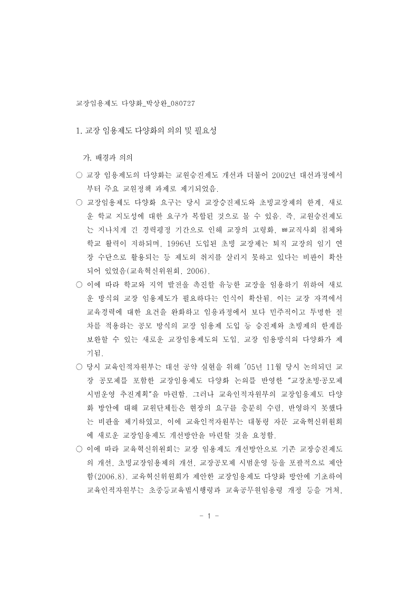

# Async page redraw

Font-outline and picture completion repainted the native canvas directly. That erased the four margin guides drawn by `PageRenderer`. The adapter now notifies the attached `CanvasView`, which uses the existing `document-page-invalidated` flow to repaint the page and its decorations. Detached adapter rendering keeps its direct fallback.

The listener is removed only by its owning view. Existing document, canvas-paint token and attachment checks still reject callbacks for replaced/closed documents and detached canvases.

## Live result

Real headless Studio at `http://127.0.0.1:7733/?engine=heemang`, using the 92-page `d-1341000-research-report-foot-cd72258675b5.hwp` and fixture Pi hub. The harness clicks the same visible 228-character paragraph, sends Korean composition start/update/commit and English input events, then compares each settled canvas with a full redraw.

- Before: 7 of 41 composition/input frames differed. The first difference was exactly 247 guide pixels; body glyphs matched.
- After: 0 of 41 differed in two fresh-context checks. Rendering settled after each full refresh, with no continuing repaint calls and no page errors.
- Both image captures below are the first composition-start frame after font refill.
- Native WASM was unchanged between these checks, SHA-256 `8174d3ba83a10a83fecadcec83a1b301081c1d57bf26805eb5d07adde8af9728`.

| Before | After |
| --- | --- |
|  |  |

Raw observations and exact input/source hashes are in `before.jsonl`, `after.jsonl` and their manifests. These correctness checks ran alongside other work; their latency fields are excluded from performance acceptance.

Live command from the Studio lane, whose current performance harness is `rhwp/rhwp-studio/e2e/heemang-verify/cold-open-bench.mjs`:

```sh
HV_BASELINE=/private/tmp/heemang-perf-resume/baseline-main \
HV_CANDIDATE_VITE_PORT=7733 \
node rhwp/rhwp-studio/e2e/heemang-verify/cold-open-bench.mjs \
  --mode=typing --docs=report --apps=candidate --runs=1 --warmup=0 --verify
```

## Focused checks

`node --test --test-concurrency=1 tests/heemang-font-flow.test.ts tests/canvas-view-initial-load-race.test.ts tests/canvas-view-page-lifecycle.test.ts`: 25 passed. Coverage includes outline readiness, replacement, close, detached canvases, picture completion/coalescing, fallback painting and document lifecycle. TypeScript passes with `tsc --noEmit`.
