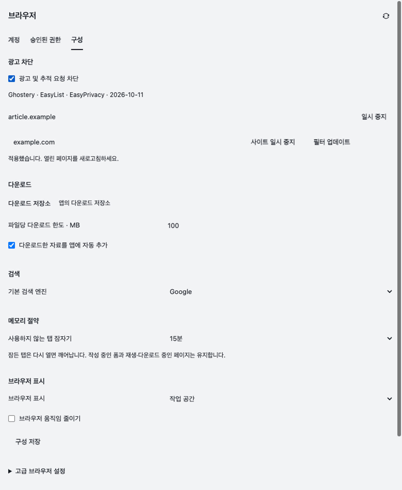
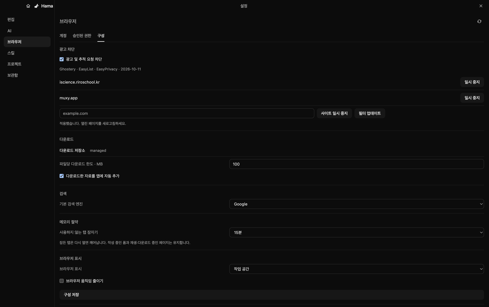

# Native browser ad blocking

Verified on 2026-10-11 with Electron 43.4.0 on macOS arm64. The implementation uses Ghostery Adblocker 2.20.1 and unmodified EasyList/EasyPrivacy snapshots. The 4.0 MiB serialized engine loads from the application bundle on the first offline launch. One engine is shared by the native browser's tabs and popups.

## Choice and sources

- [Electron extension support](https://www.electronjs.org/docs/latest/api/extensions) documents partial Chrome extension support. A complete Chrome extension installation adds compatibility requirements beyond this browser's API.
- [Ghostery's Electron adapter](https://github.com/ghostery/adblocker/tree/v2.20.1/packages/adblocker-electron) supplies request conversion, network matching, CSP filters and cosmetic injection. HamaEditor delegates to those methods and uses the original sandboxed preload. It contains no custom advertising-domain rules or matcher.
- [Electron WebRequest](https://www.electronjs.org/docs/latest/api/web-request) permits one listener per event. The existing guarded-proxy/protocol/password-shield handler remains first. It calls Ghostery only after its security checks pass. The adapter's `enableBlockingInSession` convenience method is intentionally unused because it replaces that handler.
- [Ghostery's MPL-2.0 license](https://github.com/ghostery/adblocker/blob/v2.20.1/LICENSE) and [EasyList licensing](https://easylist.to/pages/licence.html) govern the included third-party material. The bundle carries both license texts, attribution, and the complete compressed filter sources. EasyList/EasyPrivacy data is distributed under GPL-3.0-or-later.

## Behavior

Browser settings contains an enabled checkbox, per-host pause/resume controls, and a filter update button. Changes save locally and affect subsequent requests. Cosmetic changes apply after the user refreshes the page, as indicated in the UI. Settings never reload a form automatically.

The update downloads only the fixed EasyList and EasyPrivacy URLs, with credentials omitted, redirects rejected, a 15-second timeout, and an 8 MiB limit per response. A failed update preserves the working engine. A successful update writes a cached engine atomically. Invalid or older cached engines fall back to the bundled version. No page addresses, request bodies, forms, password values, or filter-match telemetry are sent to the filter servers.

Network rules cover subresources including frame requests. Ghostery's preload performs top-frame cosmetic hiding. Extended selectors and uBlock scriptlet/resource bundles are not enabled by these two lists. This is native-browser blocking; the separate managed Chromium/sign-in browser is unchanged. Site-specific advertising such as YouTube video ads has not been claimed as verified.

## Verification

`node --test tests/desktop-browser-adblock.test.mjs` passed in an isolated real Electron app using the production browser host, production browser settings pane, native preload/IPC, and guarded proxy. Fixture HTTP servers stand in for websites. `article.example` resolves only through the fixture's injected DNS lookup to loopback; no external advertising server is contacted.

The native run verified:

- An ordinary script loaded while zero requests to the EasyList-matching advertising script reached the server. The advertising element was hidden by the shipped cosmetic filter.
- Native mouse clicks in the production settings pane paused and resumed the site and switched global blocking off/on. Requests were allowed while paused/disabled and blocked after re-enabling. The unfinished draft was preserved before the user-controlled reload.
- Form POST navigation succeeded. Disconnecting the guarded proxy still cancelled requests, including while the blocker was present.
- An offline update failure kept blocking. A successful fixture-backed update used only the two configured source URLs, cached the engine, and continued blocking. Recreating the blocker offline restored the saved disabled state, paused site, and cached update time.

Additional checks passed:

| Check | Result |
| --- | --- |
| `node --test tests/desktop-browser-oauth-popup.test.mjs` | Native opener, redirects, postMessage, popup cancellation/closure and password-family protection with Ghostery enabled |
| `node --test tests/desktop-browser-passwords-native.test.mjs` | Real native password filling/submission and protected transport with Ghostery enabled |
| `node --test tests/desktop-browser-webauthn.test.mjs` | Five WebAuthn tests, including the separate native virtual-authenticator fixture |
| `node --test tests/desktop-owned-browser.test.mjs` | Three checks including native input/form preservation, real PDF download, sleeping tabs and presentation transitions; activity fixture runs with Ghostery |
| `npm run test:sidebar -- browser-settings` | Existing browser settings UI and fixture isolation |
| `npm run build:sidebar` | Standalone production sidebar build |
| `npx tsc --noEmit`, from `rhwp/rhwp-studio` | Passed |
| `git diff --check` | Passed |

The OAuth fixture previously assumed a human tab belonged to `fixture-chat`. That assertion also failed without the blocker because shared human tabs use a null chat binding. It now compares the popup binding to its actual parent and retains the remaining native OAuth behavior checks.

The final focused run measured 93 ms to dynamically import Ghostery and deserialize the bundled engine, with a 7.94 MiB JavaScript heap increase at the measurement boundary. Earlier runs measured 86–105 ms. These are cold initialization observations, not a retained-memory benchmark. Per-tab engine copies are avoided.

Electron-builder's installed production dependency collector was run against the updated package graph. It included the Ghostery engine, adapter and preload, and excluded `electron` and `@electron/get`. Package verification now requires the engine, sources, notices and preload files. A signed distributable build was not produced in this worktree.

## Integrated live Electron check

Integrated into `fix/browser-interaction-latency` at signed merge `2e4f3e3d`, preserving the unrelated local memo setup. Reinstalled root dependencies and reloaded the actual Electron build from Rauhwpx-pr475, serving http://127.0.0.1:7745/ with adsf.hwpx open.

On its existing public Muxy native tab, a normal same-origin fetch returned HTTP 200. A request to `https://pagead2.googlesyndication.com/pagead/js/adsbygoogle.js` failed, and Chromium emitted `Network.loadingFailed` with `net::ERR_BLOCKED_BY_CLIENT`. This confirms live request cancellation rather than only filter matching in a mock. No password page or private form was inspected.

Opened the production Settings / Browser / Configuration UI and toggled advertising protection off and back on. The local desktop state reflected each change. Left protection enabled, no paused sites, and preserved the original Google search preference.

