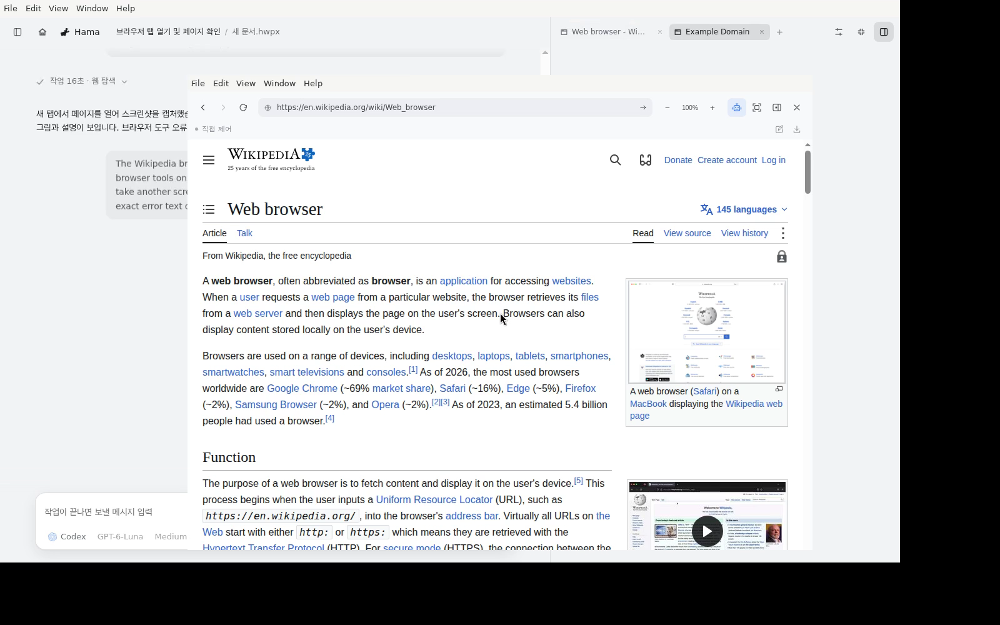
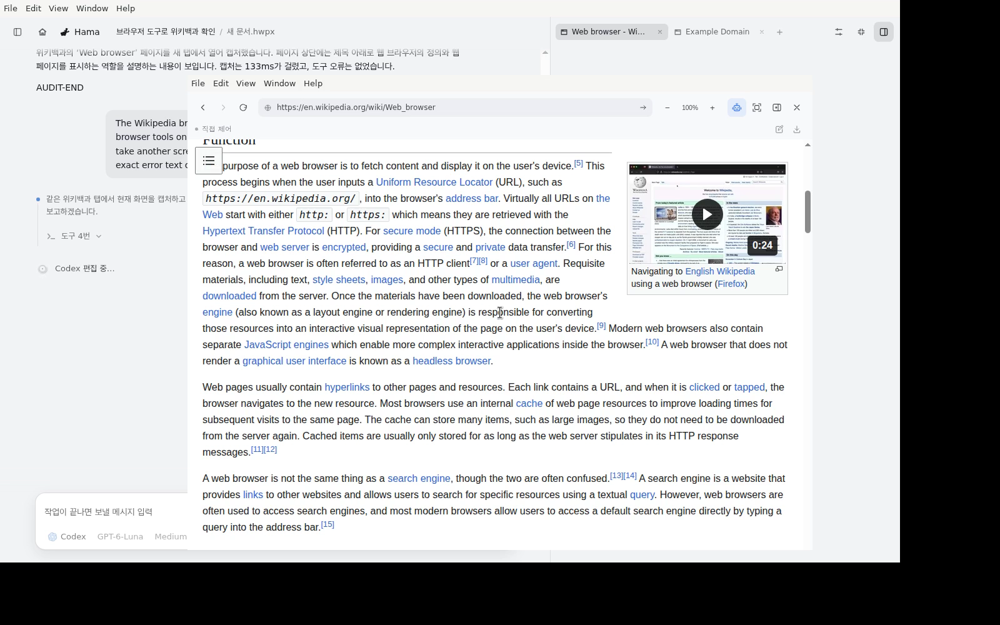

# Browser-agent benchmark recipe and results

## Recipe

Run the preparation from the repository root of the benchmark worktree. Install the project dependencies, build WASM, and install the pinned managed Chromium. Keep the browser cache persistent across runs.

```sh
cd /path/to/Rauhwpx
npm run setup
npm run build:wasm
export PLAYWRIGHT_BROWSERS_PATH="$PWD/.tools/owned-browser-chromium"
node rhwp/rhwp-agent/node_modules/playwright-core/cli.js install chromium
export CHROME_PATH="$PLAYWRIGHT_BROWSERS_PATH/chromium-1248/chrome-linux64/chrome"
export PUPPETEER_EXECUTABLE_PATH="$CHROME_PATH"
```

Authenticate the existing Claude and Codex CLI sessions on the benchmark machine. Install and configure the existing usage gate at `~/.claude/skills/pr-parity-watch/scripts/gate.sh`; the suite invokes it before every provider run and refuses runs when the gate is unavailable. The active arms are bare Claude Haiku 5.5 and Codex GPT-6 Luna at medium effort; verify the selected subscription funding and executed model before each turn. The default two subscription arms make no OpenRouter inference requests.

The suite covers ten real-site tasks, two arms, and three interleaved repetitions per task, for 60 rows per round. Use a checkpoint directory outside the checkout:

```sh
export BENCH_DIR="$HOME/.rhwp-browser-bench/example"
mkdir -p "$BENCH_DIR"
node rhwp/rhwp-studio/bench/browser-agent-suite.mjs --probe --budget-usd=20 --timeout-ms=300000 --out="$BENCH_DIR/browser-probe.json"
```

For a new experiment, establish a new baseline first and compare candidate/final rounds to that baseline. Store all checkpoints under `BENCH_DIR`; source or configuration changes require a new output path. Apply the proposed shared-tool change before the candidate command. Revert losing changes before the final command.

```sh
node rhwp/rhwp-studio/bench/browser-agent-suite.mjs --execute --label=baseline --round=baseline --reps=3 --effort=medium --budget-usd=20 --timeout-ms=300000 --out="$BENCH_DIR/baseline.json"
node rhwp/rhwp-studio/bench/browser-agent-suite.mjs --execute --label=candidate --round=candidate-1 --reps=3 --effort=medium --budget-usd=20 --timeout-ms=300000 --baseline="$BENCH_DIR/baseline.json" --compare-to="$BENCH_DIR/baseline.json" --out="$BENCH_DIR/candidate-1.json"
node rhwp/rhwp-studio/bench/browser-agent-suite.mjs --execute --label=final --round=retained-fixes --reps=3 --effort=medium --budget-usd=20 --timeout-ms=300000 --baseline="$BENCH_DIR/baseline.json" --compare-to="$BENCH_DIR/baseline.json" --out="$BENCH_DIR/final.json"
node rhwp/rhwp-studio/bench/agent-live-compare.mjs "$BENCH_DIR/baseline.json" "$BENCH_DIR/candidate-1.json" "$BENCH_DIR/final.json" --json
```

The exact final command used on 2026-10-16 referenced these private audited strict-v2 files. Future experiments need a fresh baseline on the same Asia/Seoul date as their candidates:

```sh
node rhwp/rhwp-studio/bench/browser-agent-suite.mjs --execute --label=final --round=retained-fixes --reps=3 --effort=medium --budget-usd=20 --timeout-ms=300000 --baseline="$BENCH_DIR/baseline-strict-v2.json" --compare-to="$BENCH_DIR/baseline-strict-v2.json,$BENCH_DIR/shared-1-strict-v2.json,$BENCH_DIR/shared-2-strict-v2.json" --out="$BENCH_DIR/final.json"
```

Resume an interrupted round with its original command and output path. Strict speed comparisons require three successful attempts on both sides, matching task definition, executed model, medium effort, and Asia/Seoul benchmark day. The deadline is 1.5× the best successful baseline median; tasks without a successful baseline use the 300-second cap. Strict-v2 scorer hash: `6ed6f4df746db427e5f43e211736d618c79b7b12ec83dcf36623fb91a87bfbd1`. Semantic task hash: `8ba05c3b674e71eb10c9fb457d246e746648e5bfb79e065e373bef54e4aca9c0`.

## Results

The baseline was measured from a dirty source tree containing shared correctness fixes atop commit `ee91a94`. Its source fingerprint was `ab00148d1c34babfb1a7ff447b4572efe7c80318c94108729357b983fe964fcd`; it represents the optimization starting point for this experiment.

| Round | Passed | Strict eligible median speedup (Haiku / Luna) | Invalid calls (Haiku / Luna) | Decision |
|---|---:|---:|---:|---|
| Baseline | 40/60 | — | 8 / 5 | Reference |
| H1 compact/diet/budget | 26/60 | 1.027× / 0.910× | 9 / 9 | Rejected and reverted |
| H2 JSON formatter | 25/60 | 1.011× / 0.884× | 4 / 12 | Rejected and reverted |
| Final retained fixes | 25/60 | 0.952× / 0.918× | 6 / 8 | 2× target not reached |

The baseline allowed 300 seconds per attempt. Candidate and final deadlines use 1.5× the fastest baseline task median with three successful repetitions, shared across arms, with 300 seconds for tasks without a qualifying baseline. Pass counts include this deadline change. Strict comparisons require three-of-three success for each pair. H1 had one eligible Haiku task and four Luna tasks; H2 had one eligible Haiku task and four Luna tasks. Neither candidate met the 2× target. Across the two measured rounds, eligible median gain stayed below 10% and error counts regressed, so both candidates failed acceptance and the optimization loop stopped under the original decision rule. H1 regressed invalid calls for both arms. H2 reduced Haiku invalid calls while Luna invalid calls and navigation failures regressed. The retained frame-clipping change is a correctness fix and carries no performance claim.

The final round used bare Claude Haiku 5.5 and Codex GPT-6 Luna CLI sessions at medium effort, with the same ten tasks and three repetitions. Runtime versions: Claude SDK `0.3.281` with bundled CLI `2.1.281`, Codex CLI `0.162.1`, and Chrome `156.0.8078.4`. All four rounds ran on the 2026-10-16 Asia/Seoul benchmark day. H1 arXiv-PDF pairs are N/A under strict-v2: their recorded 14.056-second limit is below the audited 24.410-second canonical limit.

## Final audit and artifacts

- Final strict score: **25/60, Haiku 8/30 and Luna 17/30**; source fingerprint `fd28f3b462bfcac0d18f38bc0ea9f749b55be5a21158fa9ae122fba815e06036`, base `07268c7a3dbbf65fc0e28a1a35dc00059eb787d4`.
- Current-main checks: hub 1426/1431 pass (5 skipped); Studio 2756/2759 pass (1 skipped, 2 existing TODOs); desktop 134/135 pass (1 skipped); browser 197/197 pass at concurrency 2, including license/viewer coverage; smoke 8/8; owned-browser live flows pass. Build, Studio typecheck, agent typecheck, CSS-token lint, and root CI pass (64 pass, 1 skip).
- Fixture-backed production Studio and native-host Luna flow: 15 interaction steps passed or reported informational status, including three informational rows. The hidden agent turn took 12 seconds and 2 tool calls; the popout agent turn took 21 seconds and 5 tool calls. Both had zero tool errors. Popout attach-to-dock and control ownership remained stable.
- Public slim metrics JSON: [baseline](baseline.json), [H1](shared-1.json), [H2](shared-2.json), [final](final.json). Source/scorer hashes and small before/after clips: [manifest](manifest.json), [scorecard HTML](scorecard.html), [before](before.mp4), [after](after.mp4). Raw DOM, task answers, provider transcripts, account paths, and run artifacts remain private.

## Recordings

[Before](before.mp4) and [after](after.mp4) show the popup and agent-preview flow. The after recording uses production Studio and the native Electron host with a fixture editor window on current main. The two real Luna turns completed with seven tool calls, zero tool errors, and three captured images. Twelve checks passed and three steps recorded state. The host logged a direct popout-to-dock transition.





After timing, one trailing space and one extra EOF blank line were removed. The measured and published hashes for those two files are recorded in [source-files.json](source-files.json); executable tokens are unchanged.
