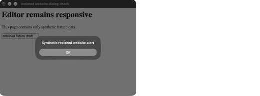
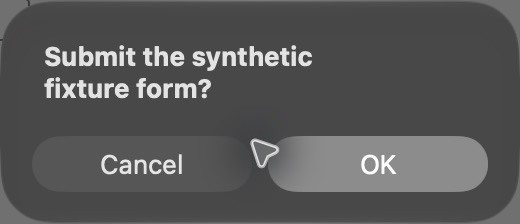

# Native website dialogs

Verified on macOS 27 with Electron 43.7.9 / Chromium 150.0.7871.250 on 2026-10-11. All captured pages contain synthetic fixture data.

An ownerless hidden website guest could enter `NSAlert.runModal` for a JavaScript alert. The Electron main process then stopped answering CDP requests, and the editor appeared frozen. A separate native fixture reproduced the stalled main-process heartbeat before the fix.

Hidden guests now remain attached to one hidden `BaseWindow`, which adds no renderer. Its visible child views retain screenshot support while `document.visibilityState` remains `hidden`. When a bound hidden guest announces a dialog, the existing debugger moves it to its validated owning editor before Electron chooses the native dialog parent. The guest stays invisible and returns to the parking window after the dialog closes. A newer dock, float or popout placement survives that close event.

Human-controlled native tabs retain explicit confirmation choices. Agent actions dismiss dialogs, including confirmations raised by agent actions on a human-owned tab. Pending dialogs are dismissed before control transfer or shutdown. Protected dialog text remains redacted on the existing CDP relay; this change passes no dialog text to the host hook. Electron's existing unsupported `prompt()` behavior is preserved.

## Visible native check

A hidden, bound fixture guest raised an alert and then a confirmation. Accessibility automation clicked the actual native **OK** buttons. Main-process heartbeat and editor renderer replies continued while both sheets were pending. The fixture confirmed acceptance, returned the guest to the hidden parking window, retained its draft, and destroyed its guest and parking window on exit.





## Persistent checks

```sh
node --test --test-concurrency=1 tests/desktop-browser-cdp.test.mjs tests/desktop-browser-dialogs.test.mjs tests/desktop-owned-browser.test.mjs tests/desktop-browser-oauth-popup.test.mjs
```

Passed **7/7** in **20.9 seconds**, with no skipped tests. The native dialog fixture checks restored alerts, human confirmation acceptance, agent cancellation without a fixture submission, editor responsiveness, hidden screenshots, protected-text redaction, stale editor rejection, newer presentation retention, and cleanup. Existing native fixtures also passed hidden-page idle/form/download retention, dock/float/popout and hub restart recovery, and OAuth popup handling. The fixture uses an external process watchdog so a main-process modal regression fails the test instead of hanging the runner.

An independent read-only review also passed the focused CDP/password tests **22/22** and found no remaining private-text forwarding or automatic confirmation acceptance.

## Primary references

- [BaseWindow and explicit WebContentsView cleanup](https://www.electronjs.org/docs/latest/api/base-window).
- [Electron debugger events](https://www.electronjs.org/docs/latest/api/debugger).
- [Electron 43.7.9 native JavaScript dialog parent selection](https://github.com/electron/electron/blob/v43.7.9/lib/browser/api/web-contents.ts).
- [Chromium emits the dialog-opening event before running the native dialog](https://github.com/chromium/chromium/blob/main/content/browser/web_contents/web_contents_impl.cc).
