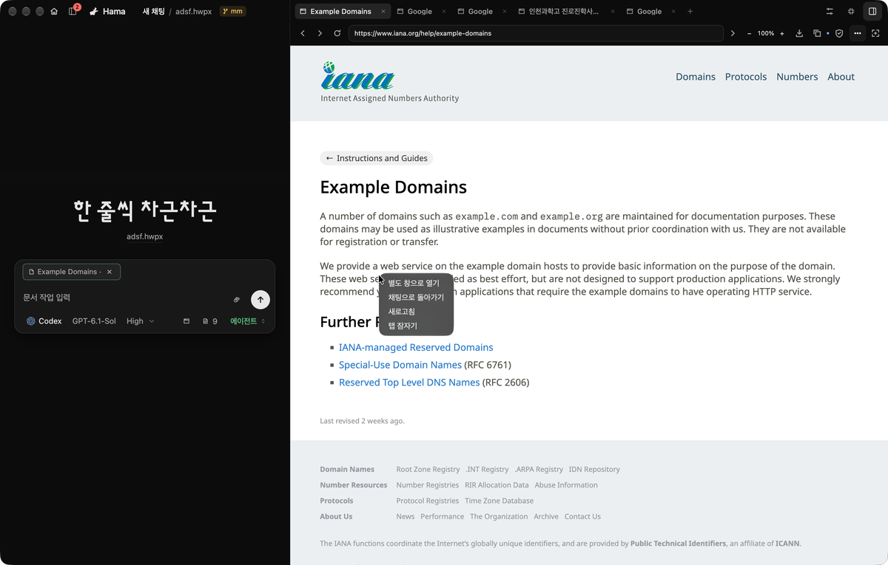
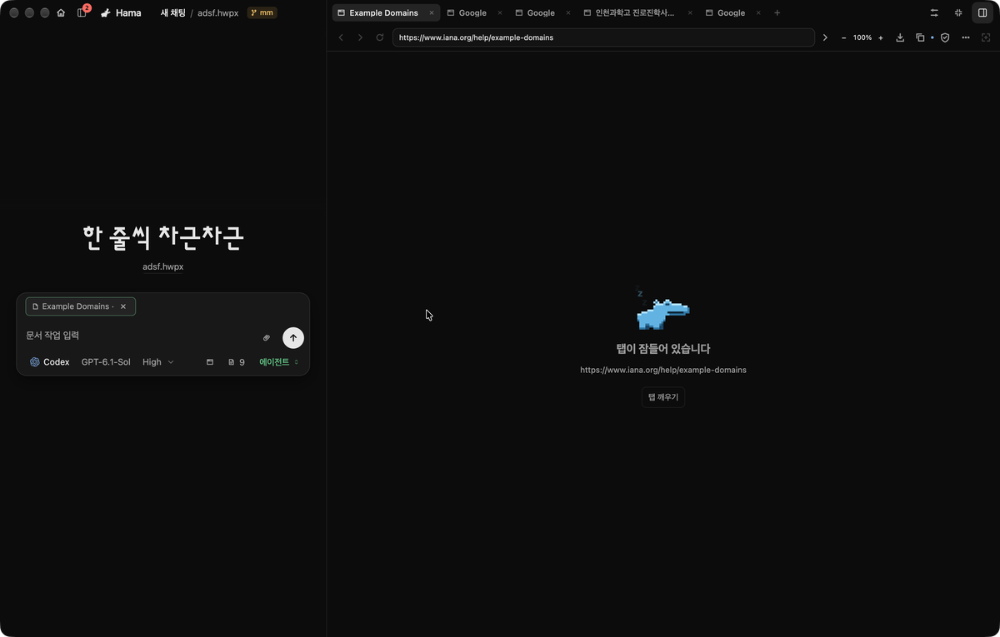
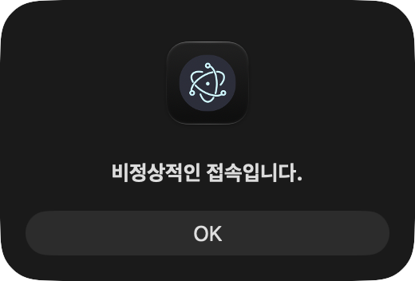

# Main integration and desktop browser verification

## Runtime

Verified on 2026-10-11 in the running HamaEditor development Electron app from `Rauhwpx-pr475`, with Studio at `http://127.0.0.1:7745`, Electron 43.7.9, and `adsf.hwpx` loaded. All four PRs (#460, #462, #475 and #481) are now merged into main. The live checks used their integrated source tree before the final version-only release change. The document remained clean; no real provider turn or personal password was submitted.

After integrating the dialog fix and relaunching Electron and Vite, the editor reported product version **3.0.0**, the hub connected, and the document remained clean. Opening a fresh browser tab failed with `BROWSER_SECURE_STORAGE_UNAVAILABLE`, reporting that the operating-system credential store was locked or unavailable. This prevents a fresh browser check in the user's profile until that store becomes available; no credentials or saved sessions were reset.

## Live checks

- Opening the browser created a focused Google tab instead of `about:blank`.
- Entering an HTTPS address in the docked and floating address fields loaded the requested site.
- Clicking the example-domain link navigated the same guest to the IANA page. The address and tab title followed navigation.
- Native zoom changed the displayed scale and reset it; floating and docked presentation retained the tab.
- Capturing the loaded page created a removable screenshot attachment in the chat composer. The test attachment was removed afterward.
- Reload retained the current HTTPS URL.
- Opening the native three-dot menu kept the page available. Choosing the fourth item, **탭 잠자기**, released the guest renderer; **탭 깨우기** recreated it at the same URL.
- The sleeping mascot screen used the dark theme.
- At a 1,440-pixel window width, clicking each of the first two browser tabs selected it. The verification tab was restored afterward. At 973 pixels, the workbench stayed compact.

## Automated checks

The integrated Studio suite passed 2,650 tests with two existing TODOs. The hub suite passed 1,395 tests with two platform skips. Focused desktop checks passed 34 cases, including actual native Electron guests, password protection, dock/float/popout identity and hub restart. Studio type checking and hub ACP type checking passed. Capture acceptance, interruption recovery and queue fixtures also passed.

The actual owned-Chromium harness initially selected a newly created Google tab while checking the original research tab. Its correction selects the existing resource and verifies the active tab identity before typing. The focused Chrome run passed 11 scenarios. All ten checks passed on PR #481 head `07c103757915999a3ccf7c64bf1b83daf6502339`, including the complete managed browser flow, downloads and project-document interactions. [Merged PR and checks](https://github.com/heemangstudio/Rauhwpx/pull/481).

## Verification limits

The macOS host became heavily loaded after the live checks (load average over 200). Subsequent startup and native-window capture attempts timed out, including an independent managed-browser run before its first scenario. A fresh live drag/resize pass after integration remains unverified; existing actual native Electron fixtures cover those paths. Local HTTP navigation requires a configured workspace preview and was intentionally rejected by policy.

After the host recovered, restoring a school page reproduced a separate freeze. The page showed `비정상적인 접속입니다.` in a native JavaScript alert. A main-process sample showed `NSAlert.runModal` occupying every main-thread sample, and the app's CDP endpoint stopped replying until the alert closed. The hidden guest had no native window owner, which made Electron display an app-modal dialog. This evidence distinguishes the website-dialog failure from the earlier host load.

The fix retains a native owner for hidden guests without adding a renderer. Native alert and confirmation sheets, human choices, agent cancellation, hidden screenshots, lifecycle races and cleanup passed seven actual Electron checks. Accessibility automation also clicked the native buttons while the editor and main-process heartbeat remained responsive. See [dialog implementation and native evidence](../browser-javascript-dialogs/README.md).

Website scripts receive values entered into their own forms and can transform or transmit them. The browser masks private fields, redacts known copied values, and blocks agent screenshot capture when private values are present; it does not claim secrecy from arbitrary scripts on the destination website. See [browser security hardening](../browser-security-hardening/README.md) and [owned browser policy](../../owned-browser.md).
