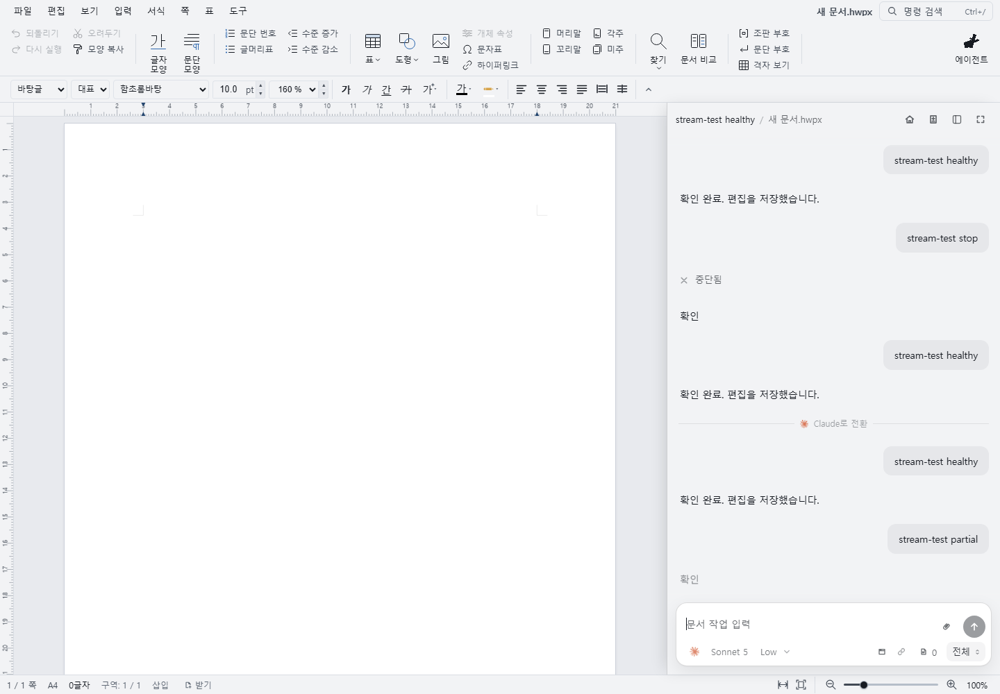
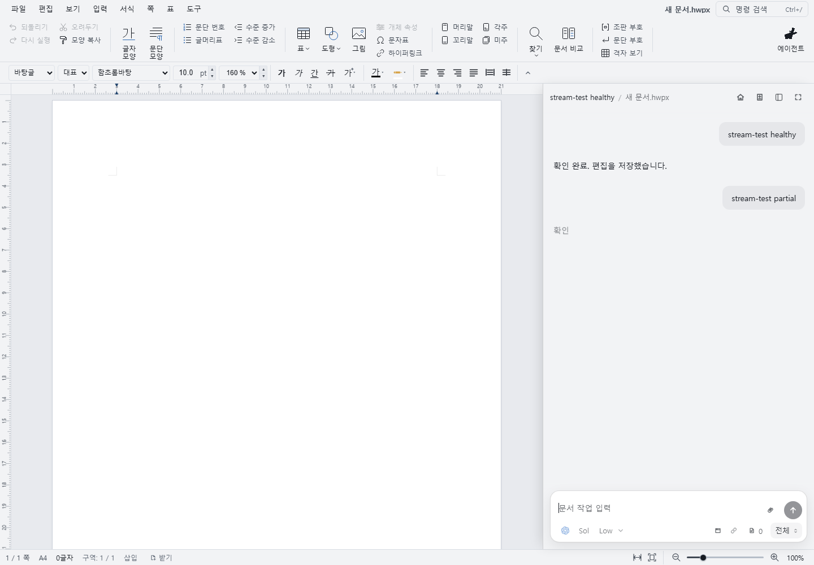
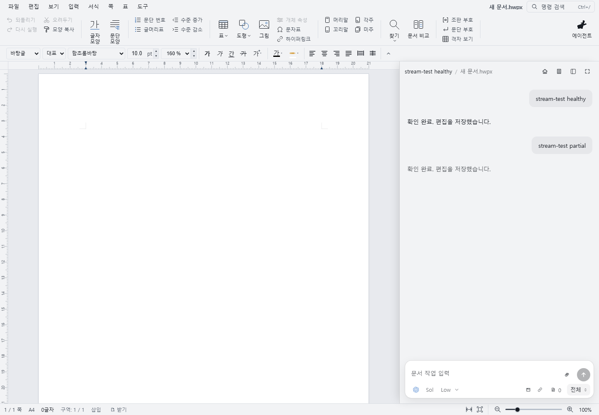

# Windows CLI streaming recovery

Verified on Windows on 2026-10-23 with Node 24.20.0, Codex CLI 0.163.0 and Claude Code 2.1.307. The paid checks used only `gpt-6-luna` and `claude-haiku-5-5` at low effort.

## Confirmed failures and fixes

The original adapters failed six new behavioral checks. A real Studio, hub and synthetic provider-process replay also reproduced truncated Claude replies, truncated or empty Codex replies, and missing text from both providers when a turn finished during a Studio socket outage.

| Trigger | Observed before | Behavior after |
| --- | --- | --- |
| Claude streams a prefix, then emits complete assistant messages | Only `확인 ` survives; the suffix and later message disappear | Reconcile each message/content block and append its missing suffix |
| Codex omits some or all message deltas | Completed message text is ignored, even though the turn succeeds | Recover text from completed items and terminal item snapshots |
| Either CLI finishes while Studio is offline | Reconnect restores the terminal result but loses the answer suffix | Replay retained text before the missed terminal result |
| Codex process exits before its stdout is drained | Late pipe reads are discarded | Drain until stdout ends/process closes, with a two-second upper bound |
| Codex stdin emits EPIPE without a process exit | The turn remains open | Close the connection, clean up the process tree and report the failed turn |
| Codex stdout emits an error | An unhandled stream error escapes the adapter | Handle it through connection cleanup |

Completed-message recovery only appends text when the streamed text is an exact prefix of the completed text. It does not append a conflicting rewritten snapshot. Offline replay is bounded to 8 MiB and 1,024 stream entries per hub record; overflow produces an explicit error. It replays text only and never repeats document writes. The buffer is in memory and does not survive a hub restart.

## Live fault injection

`e2e/provider-stream-recovery.test.mjs` runs actual child processes, the production hub, WASM editor and sidebar. The CLI output is synthetic. It does not make model requests, revoke credentials or edit the test document. It needs existing local logins to pass the hub's setup gate.

The final run passed **240/240 scenarios**, 120 per provider. Ten cycles per provider covered complete text, missing suffixes, missing deltas, duplicate completed messages, authentication failure, process crash, Stop, offline completion/reconnect, and successful subsequent turns. Each provider had its own browser context and matching sidebar preferences. Claude used the actual Agent SDK control channel; Codex used app-server JSON-RPC. The test checked captured answer text, the visible sidebar and exactly one terminal event.

Offline completion is controlled by a release file. The browser goes offline and closes its Studio socket before the provider may finish. The runner waits for the provider to write its final output, brings the browser online, and checks the recovered reply. This does not simulate a provider's remote HTTP outage.

Run from the repository root after setup and the WASM build:

```powershell
$env:CHROME_PATH = 'C:/Program Files/Google/Chrome/Application/chrome.exe'
npm --prefix rhwp/rhwp-studio run e2e:provider-stream-recovery -- --runs=10
```

Evidence is saved under `rhwp/target/provider-stream-recovery/`. The synthetic transcript files contain the test prompts and document context and are not committed.

## Actual provider editing and reconnect

`e2e/provider-stream-live.test.mjs --allow-provider-usage` passed all four actual provider turns at `http://127.0.0.1:7781/`, using a separate isolated hub for each provider. Both CLIs reused the existing local login, inserted a marker through the document tools, read it back, streamed a response, reconnected the Studio socket, and resumed the chat for another edit. The final document text contained both markers for each provider, and no provider error events were observed.

```powershell
npm --prefix rhwp/rhwp-studio run e2e:provider-stream-live -- --allow-provider-usage
```

The flag is mandatory because this check spends provider quota. Results and screenshots are saved as `rhwp/target/provider-stream-live.json` and `rhwp/target/{codex,claude}-stream-live.png`. Fresh browser OAuth authorization, forced credential expiry, and a remote provider outage were not exercised. Windows login parsing, local-login reuse, rejected credentials and setup storage were covered by the focused login/Windows tests.

## Focused checks and broader-suite limits

- Provider replay, failure classification, both adapters, Claude task/context/sandbox behavior and offline text replay: **160 passed**.
- Windows CLI launching, setup hardening, Claude login, text coalescing and terminal replay: **78 passed, 1 skipped**.
- Three question-cancellation/correlation tests that hit temporary-directory cleanup failures in the concurrent suite passed when rerun alone.
- `npm --prefix rhwp/rhwp-agent run typecheck:acp`, JavaScript syntax checks and `git diff --check`: passed.
- Studio unit suite: **2,853 passed, 5 failed, 7 skipped**. Four failures were extension-fixture syntax errors and one was an existing nested-textbox interaction contract; these areas were not changed. This suite is not claimed green.
- Full hub suite: **1,488 passed, 48 failed, 66 skipped**. It remains red on this laptop. Failures include denied symlink creation, Windows temporary-directory cleanup, POSIX-only assumptions and other live-hub fixtures. The initial broad run had 103 failures; correcting the fake CLI's `Program Files` shebang removed many launcher failures. This report does not claim the full suite is green.

The test helpers now launch Vite directly through Node and resolve fake CLI Node shebangs through PATH. This avoids the Windows npm wrapper and shebang path failures observed while starting the tests.

These are deterministic fault checks and a small real-provider sample. They do not establish a 10x improvement in real-world reliability or prove that every possible disconnect is handled.

## Before and after

These screenshots show synthetic replies in the actual Studio sidebar. The fixture's text is an output marker, not evidence that the fixture edited or saved a document.

Claude before:



Claude after:


Codex before:



Codex after:


